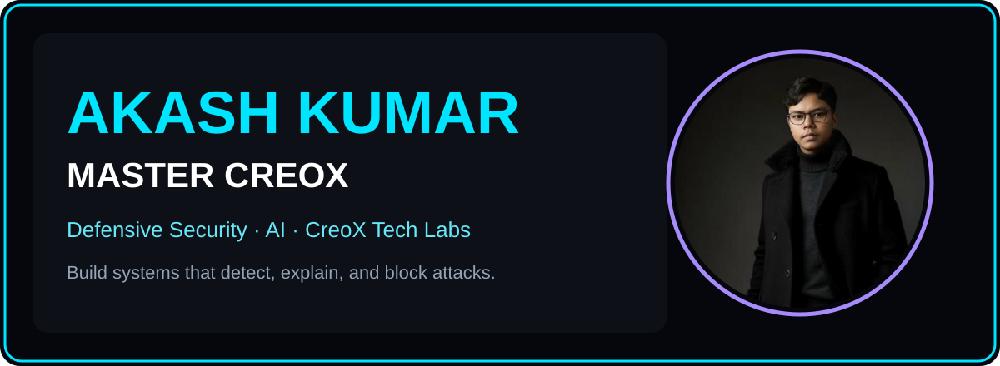
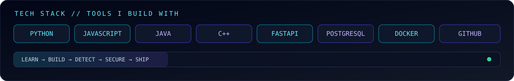
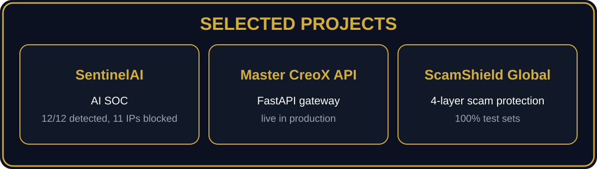
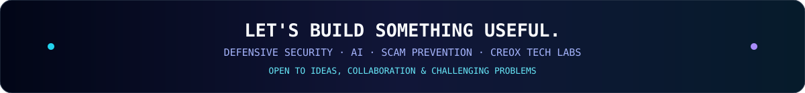

<div align="center">

<!-- ANIMATED HERO — Akash Kumar OS edition, no portrait -->


<br/><br/>

<a href="https://github.com/Master-creox"></a>
&nbsp;
<a href="https://www.linkedin.com/in/akaash-kumar/"></a>
&nbsp;
<a href="https://www.youtube.com/@CreoXTechLabs"></a>

<br/><br/>


<br/><br/>



<br/><br/>


<br/><br/>


</div>

<br/>

<div align="center">

<a href="#-selected-projects"></a>
<a href="#-tech-stack"></a>
<a href="#-achievements"></a>
<a href="#-connect"></a>

</div>

<br/>

---

## `01` ── WHO I AM

<div align="center">


<br><br>


</div>

<br>

> **Problem Solver • Defensive Security Builder • AI Builder**
>
> I'm **Akash Kumar**, also known as **Master Creox** — a BCA Cybersecurity student at JAIN College, Bangalore, and the creator of **CreoX Tech Labs** on YouTube, where I make cybersecurity-awareness content in simple English.
>
> I work at the intersection of **Defensive Security · Threat Detection & Response · AI · Scam Prevention · Secure APIs**.
>
> I enjoy taking a problem from **idea → architecture → development → testing → execution** and turning it into something useful.
>
> My focus is not simply learning technologies. It's about **using technology to build systems that detect, explain, and block attacks — and help people stay safe from scams.**

<br>

<div align="center">

### `SYSTEM PROFILE`

</div>

```text
┌──────────────────────────────────────────────────────────────────────┐
│  AKASH @ GITHUB                                                      │
├──────────────────────────────────────────────────────────────────────┤
│  ROLE       → Defensive Security Builder / AI Builder               │
│  COMPANY    → CreoX Tech Labs — Creator                              │
│  FOCUS      → Defensive Security & Threat Detection                  │
│  BUILD      → SOC Tools, Secure APIs & Scam Protection               │
│  EXPLORE    → AI for Security, Ethical Hacking (own lab only)        │
│  MINDSET    → Build → Test → Improve → Ship                          │
│  STATUS     → BUILDING                                               │
└──────────────────────────────────────────────────────────────────────┘
```

<br>

---

## `02` ── ABOUT ME

<br>

### `◈` 𝗣𝗥𝗢𝗕𝗟𝗘𝗠 𝗦𝗢𝗟𝗩𝗘𝗥

I enjoy breaking complex problems into smaller systems, understanding how the pieces interact and turning them into practical solutions.

### `◈` 𝗗𝗘𝗙𝗘𝗡𝗦𝗜𝗩𝗘 𝗦𝗘𝗖𝗨𝗥𝗜𝗧𝗬 𝗕𝗨𝗜𝗟𝗗𝗘𝗥

I build defensive tools that detect attacks, explain every decision with evidence, and respond — in my own lab and on my own systems only.

### `◈` 𝗔𝗜 𝗕𝗨𝗜𝗟𝗗𝗘𝗥

I'm particularly interested in AI that does useful security work — detection, explanation, and response — built on my own engine, not on someone else's API.

### `◈` 𝗖𝗥𝗘𝗔𝗧𝗢𝗥

Through **CreoX Tech Labs**, I turn cybersecurity into simple, practical awareness — Shorts and long videos that everyday users can actually act on.

### `◈` 𝗕𝗨𝗜𝗟𝗗𝗘𝗥

I build end to end: idea, architecture, code, tests, and a working demo. A project is done when it runs, not when it is described.

<br>

---

## `03` ── WHAT I BUILD

<br>

## `01` ── 𝗧𝗛𝗥𝗘𝗔𝗧 · 𝗗𝗘𝗧𝗘𝗖𝗧𝗜𝗢𝗡

My core work is detection with reasons. A block without evidence is a guess — so every detection in my systems carries its risk score, its failed-login count, and its baseline comparison.

### Areas I work with and explore

`Brute Force` · `Port Scan` · `DDoS` · `Credential Stuffing` · `C2 Beaconing` · `Explainable Detection` · `AI SOC`

The question I care about is not only:

> **What attacked us?**

It's also:

> **Why did we block it — and can we prove it?**

---

## `02` ── 𝗦𝗘𝗖𝗨𝗥𝗘 · 𝗔𝗣𝗜𝗦

I build APIs that are secure by default: my own key system, JWT auth, rate limiting, and usage tracking — with my own engine underneath, and no third-party AI provider in the loop.

<br>

<div align="center">


</div>

<br>

### Secure API stack

`FastAPI` · `REST APIs` · `JWT` · `SHA-256 API Keys` · `Rate Limiting` · `PostgreSQL` · `Docker`

The objective:

**Own the engine → secure the gateway → measure everything**

---

## `03` ── 𝗦𝗖𝗔𝗠 · 𝗣𝗥𝗘𝗩𝗘𝗡𝗧𝗜𝗢𝗡

Scams don't start with a hack — they start with a link, a message, or a call. I build layered protection that checks a URL, a message, and a page before a person has to trust their gut.

### Development interests

- URL risk analysis and typosquat detection
- Message analysis for OTP theft, KYC threats, and prize bait
- Client-side web shields that never send data away
- Browser extensions for everyday protection
- Awareness content that teaches the pattern, not just the warning

I care about both:

**Detection accuracy**

and

**Honest limits — no tool can guarantee 100% protection; your judgement is the final layer**

---

## `04` ── 𝗡𝗘𝗧𝗪𝗢𝗥𝗞 · 𝗦𝗘𝗖𝗨𝗥𝗜𝗧𝗬

Network security is where detection becomes real: live traffic, real packets, real patterns — analysed in my own lab, on my own systems, with authorization.

### Areas of interest

`Packet Analysis` · `DNS Inspection` · `Protocol Detection` · `Traffic Monitoring` · `Simulated SOC` · `Defensive Learning` · `Secure Development`

My approach:

> **Understand how systems work. Understand how they fail. Build them better.**

<br>

---

<a id="tech-stack"></a>

## `04` ── TECH STACK

<br>

## `// LANGUAGES`

<div align="center">


<br><br>


</div>

---

## `// AI · AUTOMATION`

<div align="center">


</div>

---

## `// WEB · BACKEND`

<div align="center">


<br><br>


</div>

---

## `// DATABASES · PLATFORMS`

<div align="center">


<br><br>


</div>

---

## `// TOOLS · ENVIRONMENT`

<div align="center">


<br><br>


</div>

<br>

---

<a id="selected-projects"></a>

## `05` ── SELECTED PROJECTS

<div align="center">



<br/>

<a href="https://github.com/Master-creox/sentinel-ai-soc"></a>
<a href="https://github.com/Master-creox/master-creox-api"></a>
<a href="https://github.com/Master-creox/scamshield-global"></a>
<a href="https://github.com/Master-creox/ethical-hacking-practice-lab"></a>

</div>

<br/>

### GitHub at a glance

<div align="center">


<br/>


</div>

<br>

## `01` ◈ 𝗦𝗘𝗡𝗧𝗜𝗡𝗘𝗟𝗔𝗜

**Role:** Builder

An autonomous AI Security Operations Center that watches network traffic, detects attacks, explains every decision, and responds on its own. In its simulated benchmark, it detected **12 out of 12 attackers** and blocked **11 IPs**.

### Focus

`Threat Detection` · `AI SOC` · `Explainable AI` · `Python`

---

## `02` ◈ 𝗠𝗔𝗦𝗧𝗘𝗥 · 𝗖𝗥𝗘𝗢𝗫 · 𝗔𝗣𝗜

**Role:** Builder

A live, self-reliant FastAPI gateway with its own API-key system, JWT auth, rate limiting, usage tracking, and its own CreoXEngine — no third-party AI providers. Live in production at [master-creox-api.onrender.com](https://master-creox-api.onrender.com/).

### Focus

`FastAPI` · `Secure APIs` · `Auth` · `Python`

---

## `03` ◈ 𝗦𝗖𝗔𝗠𝗦𝗛𝗜𝗘𝗟𝗗 · 𝗚𝗟𝗢𝗕𝗔𝗟

**Role:** Builder

Four-layer scam protection: a C++ URL risk engine, a Java message analyzer, a JS web shield, and a browser extension. It scored **100% on its bundled test sets** — and its README is honest that no tool can guarantee 100% protection.

### Focus

`Scam Prevention` · `URL Analysis` · `Java` · `C++`

---

## `04` ◈ 𝗘𝗧𝗛𝗜𝗖𝗔𝗟 · 𝗛𝗔𝗖𝗞𝗜𝗡𝗚 · 𝗣𝗥𝗔𝗖𝗧𝗜𝗖𝗘 · 𝗟𝗔𝗕

**Role:** Builder

A practice lab with 20 tools and an authorization gate — for your own devices, your own lab VMs, and vulnerable lab apps only. Never a real target. Live on GitHub Pages.

### Focus

`Practice Lab` · `Authorization Gate` · `Defensive Learning`

<br>

---

## `06` ── CREOX TECH LABS

<br>

<div align="center">


</div>

<br>

**CreoX Tech Labs** is my main focus — my YouTube channel for cybersecurity awareness.

The vision is to turn real security knowledge into simple, practical content that everyday users can act on, by combining:

**Defensive Security · AI · Threat Detection · Scam Prevention · Secure APIs**

I want to make content that is not just interesting to watch, but genuinely useful — a video someone can use to avoid a real scam the same day.

### Direction

**Identify a real threat → design the lesson → build the video → explain it simply → create value**

The long-term goal is to grow CreoX Tech Labs into a trusted place where anyone can learn to stay safe online, and to keep building the tools the channel teaches about.

<br>

---

## `07` ── EXPERIENCE

<br>

My background combines defensive security, AI, software development, and content creation.

### `▸` 𝗙𝗢𝗨𝗡𝗗𝗜𝗡𝗚 · 𝗧𝗘𝗔𝗠 · 𝗠𝗘𝗠𝗕𝗘𝗥 / 𝗧𝗘𝗖𝗛𝗡𝗢𝗟𝗢𝗚𝗬 · 𝗢𝗙𝗙𝗜𝗖𝗘𝗥 — 𝗖𝗛𝗘𝗔𝗞𝗦𝗧𝗔𝗥 · 𝗣𝗩𝗧. · 𝗟𝗧𝗗.

Founding team member and Technology Officer at Cheakstar Pvt. Ltd., working across technology and product execution.

### `▸` 𝗔𝗜 · 𝗜𝗡𝗧𝗘𝗥𝗡 — 𝗖𝗢𝗗𝗘𝗔𝗟𝗣𝗛𝗔

AI Intern at CodeAlpha, April–May 2026, remote — built a Translation Tool and an FAQ Chatbot.

### `▸` 𝗖𝗥𝗘𝗔𝗧𝗢𝗥 — 𝗖𝗥𝗘𝗢𝗫 · 𝗧𝗘𝗖𝗛 · 𝗟𝗔𝗕𝗦

Creator of CreoX Tech Labs on YouTube — cybersecurity-awareness Shorts and long videos on phishing, ransomware, social engineering, and Wi-Fi safety.

### `▸` 𝗕𝗖𝗔 · 𝗖𝗬𝗕𝗘𝗥𝗦𝗘𝗖𝗨𝗥𝗜𝗧𝗬 · 𝗦𝗧𝗨𝗗𝗘𝗡𝗧 — 𝗝𝗔𝗜𝗡 · 𝗖𝗢𝗟𝗟𝗘𝗚𝗘, · 𝗕𝗔𝗡𝗚𝗔𝗟𝗢𝗥𝗘

BCA Cybersecurity student at JAIN College, Bangalore, since March 2025 — currently in my 4th semester.

<br>

---

## `08` ── LEADERSHIP

<br>

### 🎥 𝗖𝗥𝗘𝗔𝗧𝗢𝗥 — 𝗖𝗥𝗘𝗢𝗫 · 𝗧𝗘𝗖𝗛 · 𝗟𝗔𝗕𝗦

Building and running a cybersecurity-awareness channel — from topic and script to video, thumbnail, and publishing.

### 🛡️ 𝗙𝗢𝗨𝗡𝗗𝗜𝗡𝗚 · 𝗧𝗘𝗔𝗠 · 𝗠𝗘𝗠𝗕𝗘𝗥 — 𝗖𝗛𝗘𝗔𝗞𝗦𝗧𝗔𝗥 · 𝗣𝗩𝗧. · 𝗟𝗧𝗗.

Founding team member and Technology Officer, working across technology and product execution.

<br>

---

<a id="achievements"></a>

## `09` ── ACHIEVEMENTS

<br>

<div align="center">


<br>

**SentinelAI — simulated benchmark**

12 out of 12 attackers detected, 100% recall, 0 false positives, 11 IPs blocked. All traffic in the demo is simulated.

<br><br>


<br>

**Master CreoX API — live in production**

FastAPI gateway live at master-creox-api.onrender.com, with its own engine and key system.

<br><br>


<br>

**ScamShield Global — 100% on bundled test sets**

Four-layer scam protection, verified against its bundled test sets.

<br><br>


<br>

**SentinelAI Short — published 2026-11-05**

[Watch the Short on YouTube](https://youtube.com/shorts/JMEyoNlt3fQ)

<br><br>


<br>

**LinkedIn article + BAOS post — published 2026-10-27**

</div>

<br>

---

## `11` ── CYBER LAB

<br>

<div align="center">


</div>

<br>

I'm interested in understanding both sides:

**How systems are built.**

**How systems can be broken.**

That perspective helps me build software with security in mind — in my own lab, on my own systems, with authorization. Never a real target.

<br>

---

## `12` ── CURRENTLY LEARNING

<br>

### 🤖 𝗠𝗔𝗖𝗛𝗜𝗡𝗘 · 𝗟𝗘𝗔𝗥𝗡𝗜𝗡𝗚 · 𝗙𝗢𝗥 · 𝗦𝗘𝗖𝗨𝗥𝗜𝗧𝗬

Going deeper into ML for detection — models that explain their decisions, not black boxes.

### 🏗️ 𝗦𝗘𝗖𝗨𝗥𝗘 · 𝗦𝗬𝗦𝗧𝗘𝗠 · 𝗗𝗘𝗦𝗜𝗚𝗡

Learning how to design systems that are secure by default, not patched afterwards.

### 🚀 𝗢𝗣𝗘𝗡 · 𝗦𝗢𝗨𝗥𝗖𝗘

Building in the open — shipping real projects, learning from feedback, and contributing back.

### 🔐 𝗧𝗛𝗥𝗘𝗔𝗧 · 𝗗𝗘𝗧𝗘𝗖𝗧𝗜𝗢𝗡

Strengthening knowledge in detection logic, attack patterns, and evidence-based response.

### ⚡ 𝗦𝗘𝗖𝗨𝗥𝗘 · 𝗔𝗣𝗜𝗦

Going deeper into authentication, authorization, rate limiting, and safe API design.

<br>

---

## `13` ── MINDSET

<br>

<div align="center">


<br><br>

### `BUILD > TALK`

</div>

<br>

I believe projects teach things that tutorials cannot.

The fastest way to understand technology is to use it to solve a real problem.

<br>

---

## `14` ── PHILOSOPHY

<br>

<div align="center">

### **DON'T JUST LEARN TECHNOLOGY. BUILD WITH IT.**

<br>

### **AWARENESS IS THE STRONGEST FIREWALL.**

<br>

### **PROJECTS TEACH WHAT TUTORIALS CANNOT.**

<br>

### **DETECT. EXPLAIN. BLOCK.**

</div>

<br>

---

## `15` ── INTERESTS

<br>

<div align="center">


<br>


</div>

<br>

---

<a id="connect"></a>

## `17` ── CONNECT

<br/>

<div align="center">



</div>

<br>

<div align="center">

### `Got an interesting idea?`

### `Building something?`

### `Working on defensive security, AI, or scam prevention?`

<br>

**Let's connect.**

<br><br>

<a href="https://www.linkedin.com/in/akaash-kumar/">

</a>

&nbsp;

<a href="https://www.youtube.com/@CreoXTechLabs">

</a>

&nbsp;

<a href="https://github.com/Master-creox">

</a>

</div>

<br><br>

<div align="center">


<br><br>


</div>
